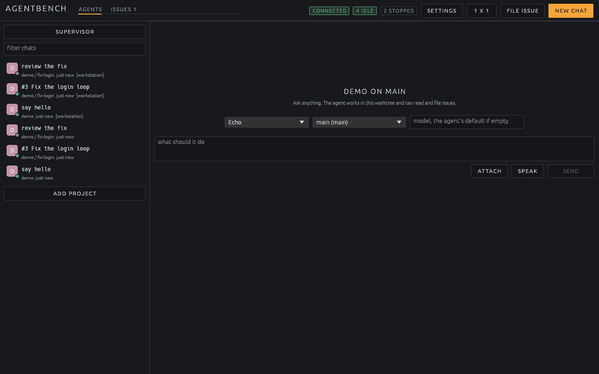
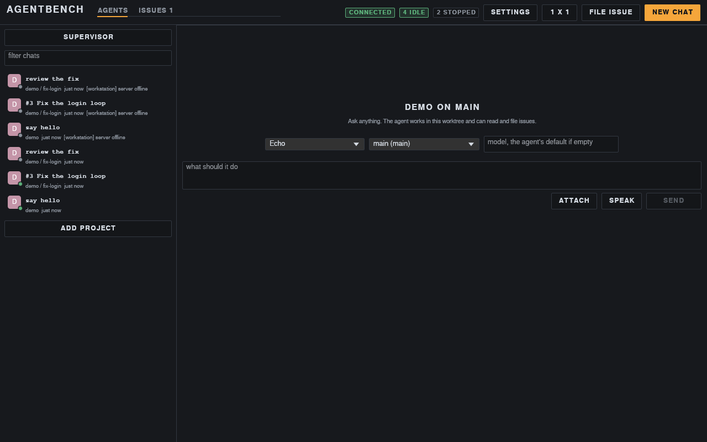

# Several servers in one window

Every machine runs an ordinary agentbench server with its own projects, chats, issues, keys and model providers. Nothing is shared or proxied between servers. The app connects to several at once and shows them as one workspace.

Add servers in Settings, under servers: a name, the address and the token printed by `agentbench token` on that machine. The first server (the one the window already used) keeps its plain ids, so existing installs work unchanged. The saved list lives in the app's settings under `servers`.

- Items from a remote server carry its name in brackets. An unreachable server shows "server offline" on its items and never blocks the others.
- Ids are per server. The app tags each remote id with the server's slot (`crates/app/src/hub.rs`) and strips it again before a request goes to the owning server, so every action reaches the right machine.
- Add project asks which server to use, defaulting to the selected project's server.
- Each server's RAM, disk and CPU load show under its entry in Settings, from the `host` block of `GET /api/overview`.

Out of scope: the supervisor and the autopilot panel stay per server and show the first server's. The web and Android clients share this code, so they get the list too.

