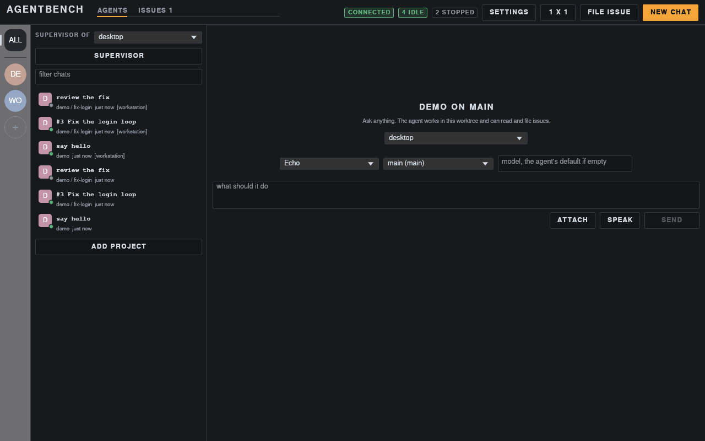
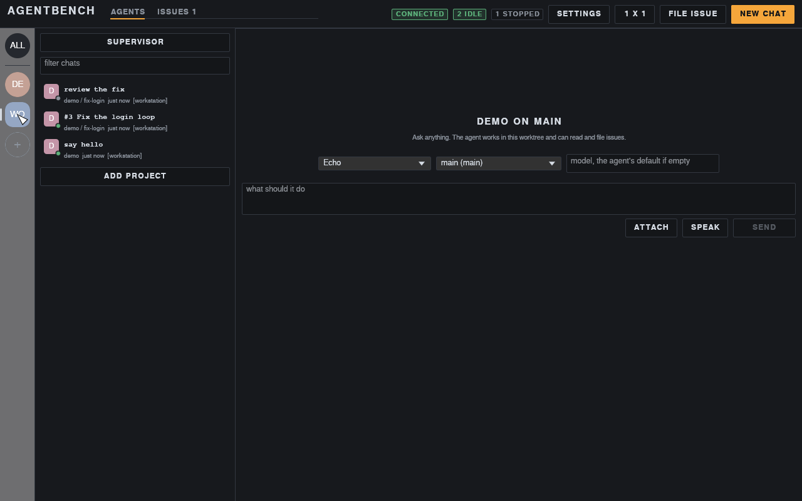
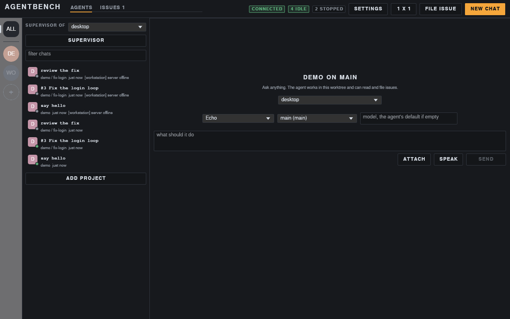
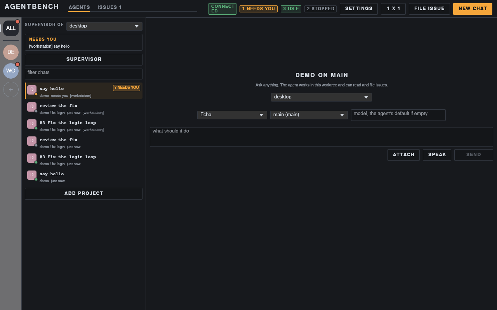

# Workspaces: several servers in one window

Every machine runs an ordinary agentbench server with its own projects, chats, issues, keys, model providers, supervisor and autopilot. Nothing is shared or proxied between servers. The app connects to several at once and calls each one a workspace.

## Adding workspaces

Click the "+" at the bottom of the workspace bar, or use Settings, workspaces (the full editor). A workspace is a name, the address, the token printed by `agentbench token` on that machine, and an optional icon (a path to a small image file, stored in the app's settings). The first server keeps plain ids, so existing installs work unchanged. With one server there is no bar.

## The bar

A narrow bar on the far left, one round icon per workspace:

- **ALL** at the top shows every workspace together. Items from a non-local workspace carry its name in brackets.
- Clicking a workspace narrows projects, chats, issues, worktrees and the grid to it. The choice is saved.
- An icon shows the workspace's image, or its initials on a colour taken from the name. A red dot means a chat is waiting for you or a proposal is pending, a green dot means agents are working, and a greyed icon means the server is offline (its items stay, marked "server offline", and never block the others).
- Hovering shows the name, URL and RAM, disk and CPU from `Overview.host`.

## Supervisors

Each server runs its own supervisor, autopilot and triage. The app shows the selected workspace's. In the ALL view a "supervisor of" switcher picks which workspace's supervisor the supervisor key opens (the first by default). A "needs you" panel lists every workspace's waiting chats and pending proposals; clicking one opens it on its own workspace. Proposal cards (including add project) are answered on the server that raised them, and the window title counts waiting chats across all workspaces.

## Creating things

In a workspace's own view, new chats, issues and projects go to that workspace. In ALL, new chat, file issue and add project offer a workspace picker; the start-an-agent dialog lists projects from every workspace with their badge. Terminal, file viewer, attachments and chat actions follow the session's workspace.

## How it works

Ids are per server, so the app tags each non-first id with the workspace slot (`crates/app/src/hub.rs`) and strips it before a request goes out. Web and Android share this code and get the bar too.
